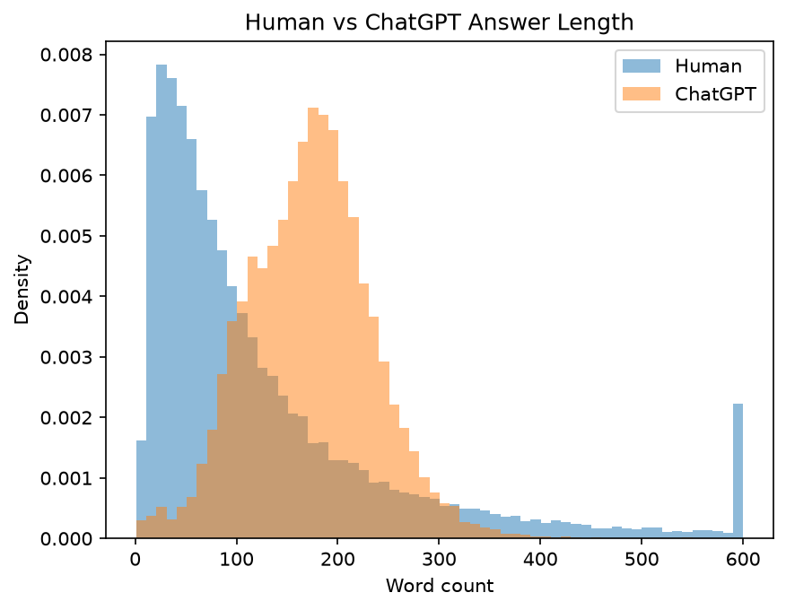
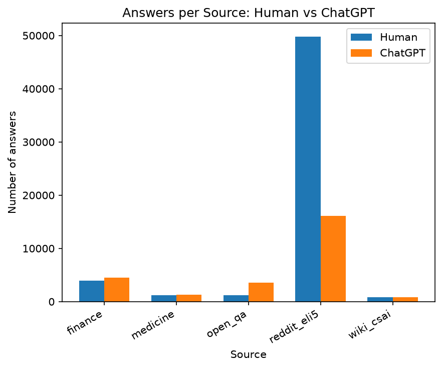
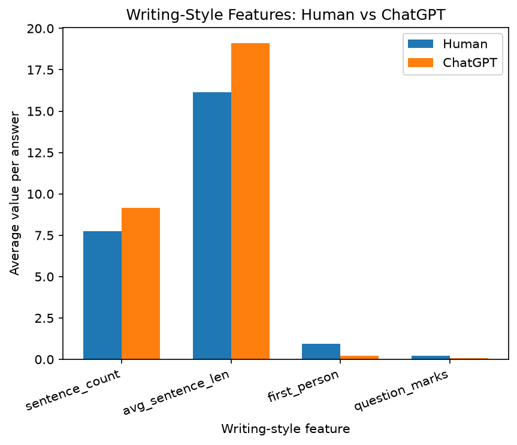
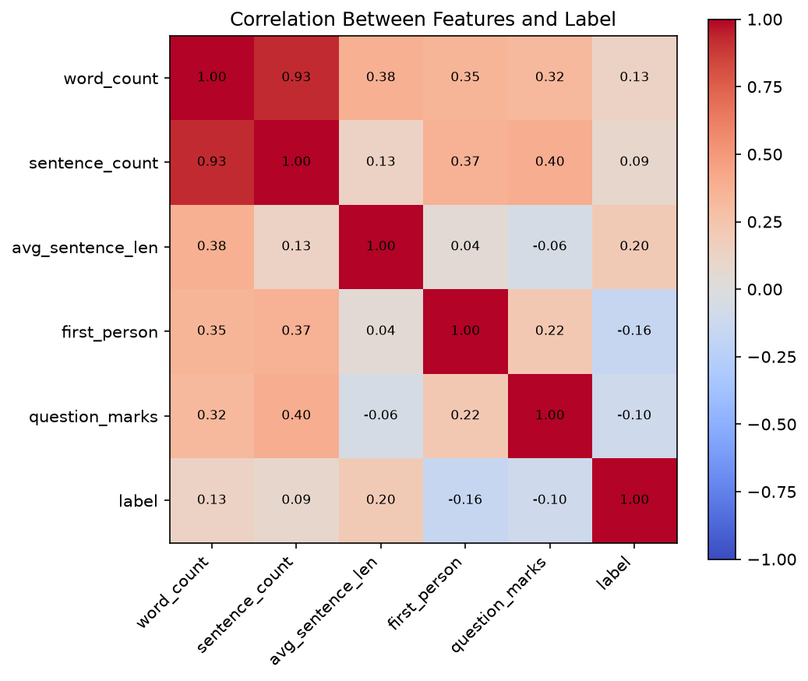
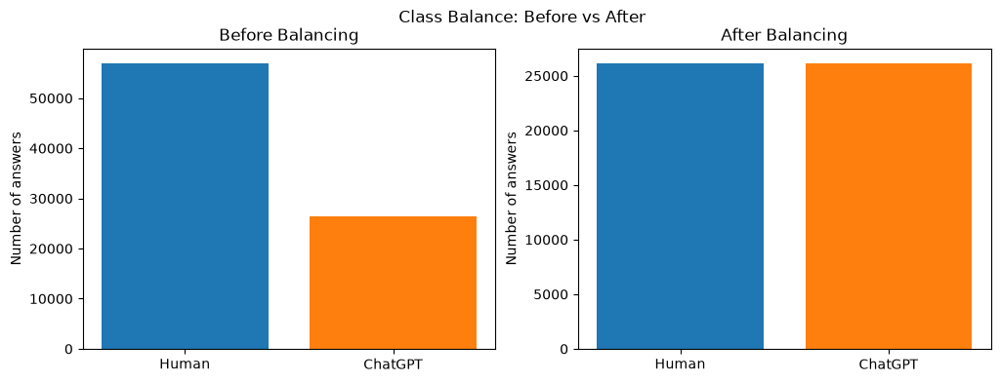

# AI-Generated Content Detection Pattern

Detecting Human vs. ChatGPT-Written Answers Using the HC3 Dataset

## Industry

**Technology — Artificial Intelligence & Digital Content Integrity / Moderation.** Generative language models such as ChatGPT can now produce answers that read as fluently as human writing. This has created a fast-growing industry of detection tools and platform safeguards used across education, publishing, social media and customer support — all of which rely on identifying measurable differences between human and AI text.

## Problem Statement

With ChatGPT and similar models now able to generate fluent, human-like answers at scale, it is increasingly hard to tell whether a piece of text was written by a person or a machine. Undetected AI text threatens academic integrity, lets misinformation spread under a false air of authenticity, and strains content moderation and trust at platform scale. This affects students & educators, platform moderators (Reddit, Quora, forums), journalists & publishers, and employers or readers judging whether written work is genuine.

## Proposed Solution / Analysis Questions

Rather than jumping straight to a black-box classifier, this project first uses descriptive and exploratory Python analysis to surface measurable, human-interpretable stylistic signals — producing a clean, balanced dataset and an EDA report that can ground a future AI-content classifier (e.g. a TF-IDF + Logistic Regression baseline).

Key analysis questions:

- How does answer length (word count) differ between Human and ChatGPT answers?
- Do Human and ChatGPT writing styles differ in sentence structure and sentence length?
- How often do Human vs ChatGPT answers use first-person language and embedded questions?
- How is the data distributed across content sources — Reddit ELI5, finance, medicine, open QA, Wikipedia?
- Which features correlate most strongly with the authorship label?
- After cleaning and balancing, is the dataset large and clean enough for future model training?

## Dataset

- **Dataset Name:** HC3 — Human ChatGPT Comparison Corpus
- **Dataset Source:** [HC3 — Hello-SimpleAI/HC3](https://huggingface.co/datasets/Hello-SimpleAI/HC3) (the `all` subset), via Hugging Face

Each row pairs a question with one or more human answers and one or more ChatGPT answers, drawn from sources such as Reddit ELI5, finance, medicine, open QA, and Wikipedia CS/AI.

## Tools & Technologies

- Python 3
- Jupyter Notebook
- NumPy
- pandas
- Matplotlib

## Project Workflow

Industry Selection → Problem Identification → Dataset Collection → Data Cleaning → Data Transformation → Data Analysis → Data Visualization → Insights → Recommendations

## Folder Structure

```
ai-generated-content-detection/
│
├── README.md
├── Dataset/
│   ├── raw_dataset.csv          ← original HC3 "all" data
│   └── cleaned_dataset.csv      ← output of the cleaning pipeline
├── Notebook/
│   └── Data_Analysis_EDA.ipynb  ← full, annotated analysis notebook
├── Python/
│   ├── data_loading.py
│   ├── data_cleaning.py
│   ├── exploratory_analysis.py
│   └── data_visualization.py
├── Visualizations/
│   ├── distribution_analysis.png
│   ├── category_analysis.png
│   ├── trend_analysis.png
│   ├── correlation_analysis.png
│   └── class_balance_analysis.png
└── Documentation/
    ├── Project_Report.pdf
    └── AI_Content_Detection_Presentation.pptx
```

## How to Run

Install dependencies:

```
pip install pandas numpy matplotlib
```

**Option A — run the scripts** (from the project root, in order):

```
python Python/data_loading.py
python Python/data_cleaning.py
python Python/exploratory_analysis.py
python Python/data_visualization.py
```

`data_cleaning.py` writes `Dataset/cleaned_dataset.csv`; `data_visualization.py` writes the PNG charts to `Visualizations/`.

**Option B — open the notebook:**

```
jupyter notebook Notebook/Data_Analysis_EDA.ipynb
```

## Cleaning Steps Summary

1. Load `raw_dataset.csv`, drop the unused `index` column and 509 duplicate rows → **23,813** question rows.
2. Parse the `human_answers` / `chatgpt_answers` JSON lists and explode them into one row per answer, labeling each row (0 = Human, 1 = ChatGPT). Remove null/blank answers → **83,400** answers (57,019 Human, 26,381 ChatGPT).
3. Compute word count and writing-style features (sentence count, average sentence length, first-person usage, question marks).
4. Fix spacing artifacts and remove the giveaway phrase "As an AI language model".
5. Drop answers under 20 words and duplicate answer text → 49,018 Human / 26,173 ChatGPT.
6. Balance the two classes (random_state=42) → **52,346** answers, **26,173 per label**, saved as `cleaned_dataset.csv`.

## Data Analysis & Visualization

- **Distribution Analysis** — histogram comparing Human vs ChatGPT answer length (word count).
- **Category-wise Analysis** — grouped bar chart of answer counts per source, split by Human vs ChatGPT.
- **Comparison / Trend Analysis** — grouped bar chart comparing average writing-style features (sentence count, average sentence length, first-person usage, question marks) between Human and ChatGPT.
- **Correlation Analysis** — correlation heatmap between word count, writing-style features, and the label.
- **Class Balance Analysis** — bar charts comparing Human vs ChatGPT answer counts before and after balancing the dataset.

## Visualization Screenshots

### Distribution Analysis



### Category-wise Analysis



### Trend Analysis



### Correlation Analysis



### Class Balance Analysis



## Key Insights

- ChatGPT answers are longer (median 174 words vs 83 for human) and much more consistent in length.
- Humans use first-person words (I, me, my) about 4.5 times more often (0.95 vs 0.21 per answer).
- Humans ask more questions inside answers (0.22 vs 0.07 question marks per answer).
- ChatGPT writes longer sentences (19.1 vs 16.1 words per sentence).
- No single feature strongly correlates with the label alone (max |r| = 0.20) — a combination of features would be needed for reliable classification.
- Final dataset: 52,346 answers, balanced 50/50, saved as `cleaned_dataset.csv`.

## Recommendations

- Build a TF-IDF + Logistic Regression baseline classifier on top of this cleaned, balanced dataset.
- Split train/test by question, not by answer, so answers to the same question never leak across the split.
- Evaluate performance separately per source (Reddit ELI5 vs finance/medicine/open QA/wiki_csai).
- Re-test findings against newer-generation LLMs, since HC3's ChatGPT answers are GPT-3.5-era and the style gap may be narrowing.

## Author

- **Name:** Anto Jeberz J
- **Student ID:** AF05310496
- **Organization:** Anudip Foundation
- **Course:** AIML
- **Batch Code:** ANP-D7444
